<p align="center">
  <picture>
    <source media="(prefers-color-scheme: dark)" srcset="docs/assets/banner-dark.svg">
    
  </picture>
</p>

<p align="center">
  <b>See what Claude is doing, what it costs, and when your limits run out,<br>without leaving the prompt.</b>
</p>

<p align="center">
  <a href="https://github.com/kevinCodeSavvy/cockpit/releases"></a>
  
  <a href="LICENSE"></a>
</p>

<p align="center">
  <a href="#install">Install</a> · <a href="#whats-inside">What's inside</a> · <a href="docs/guide.md">Guide</a> · <a href="https://github.com/kevinCodeSavvy/cockpit/releases">Releases</a>
</p>

<p align="center">
  
</p>

## Why

cockpit puts three small tools above the prompt: **Deck** (the panel), **next-steps** and the **Jev model router**. One install.

| When… | Without it | With cockpit |
|---|---|---|
| the prompt cache is about to go cold | The next reply quietly costs more | The Cache row turns red in the last minute, with the cost of a re-write |
| your usage is climbing | You find out at the limit | The row says when you'll hit it, if that comes before the reset |
| one task is a typo and the next is a migration | Every task gets the same effort | Jev picks the reasoning effort for each task and shows how sure it was |
| a reply ends and you're not sure what to ask next | You think of the next prompt yourself | Up to three suggestions; press 1, 2 or 3 to draft one |

## Install

```
/plugin marketplace add kevinCodeSavvy/cockpit
/plugin install cockpit@cockpit
```

Restart Claude Code (or run `/reload-plugins`), then run `/deck demo` to see a sample panel.

> [!NOTE]
> Needs Claude Code 2.1.287 or later. Works in Claude Code Desktop and the terminal. Model routing works with no key, using Claude Code's built-in classifier; a TypeSafe key adds Jev's confidence score (see the [guide](docs/guide.md#set-up-jev-model-routing)).

Update with `claude plugin update cockpit@cockpit`.

## What's inside

### Warns before the cache goes cold



In the last minute the row turns red and shows what a cold re-write would cost. Send any message to warm it again.

### Tells you when you'll hit a limit



If your pace would reach the 5-hour or 7-day limit before it resets, the hit time replaces the reset countdown. It's an estimate, and needs about five minutes of rising usage.

### Picks the effort for each task



[Jev](https://typesafe.ai/blog/introducing-system-one-models-and-jev) judges each prompt and sets the reasoning effort. Subagents get a model to match. Your main chat's model is only switched if you turn on `routeMainModel`, because switching mid-session throws away the cache.

### Suggests what to do next



Up to three ideas after each reply. In the terminal press <kbd>1</kbd>, <kbd>2</kbd> or <kbd>3</kbd>; in Desktop run `/next 1`, `/next 2` or `/next 3`. <kbd>0</kbd> dismisses.

Deck also shows context, spend and the pet, in six bar styles. See the [guide](docs/guide.md#bar-styles).

## Settings

Show or hide rows and change the look with `/deck` commands, for example `/deck style`, `/deck cache 5m` or `/deck collapsed rings`. Every command is in the [guide](docs/guide.md#cockpit-commands).

## Cost and privacy

- **Local by default.** With no key, nothing leaves your machine.
- **With a TypeSafe key,** the text of each prompt is sent to `api.typesafe.ai` to be classified. Saved logs keep only a redacted 200-character summary.
- **Your key stays private.** You enter it at a hidden prompt, and Claude Code stores it as a sensitive value.
- **Spend is API-equivalent dollars.** On a subscription it isn't a bill.

## Documentation

- [Guide](docs/guide.md): first run, Jev setup, bar styles, every command, and what changed from the originals.
- [Deck](plugins/deck/README.md), [next-steps](plugins/next-steps/README.md) and [jev-model-router](plugins/jev-model-router/README.md): each plugin in detail.
- [Credits](CREDITS.md): this bundles other people's work, with changes.

## License

[MIT](LICENSE). Each bundled plugin keeps its own licence. This project is independent and not made or endorsed by Anthropic or TypeSafe.
