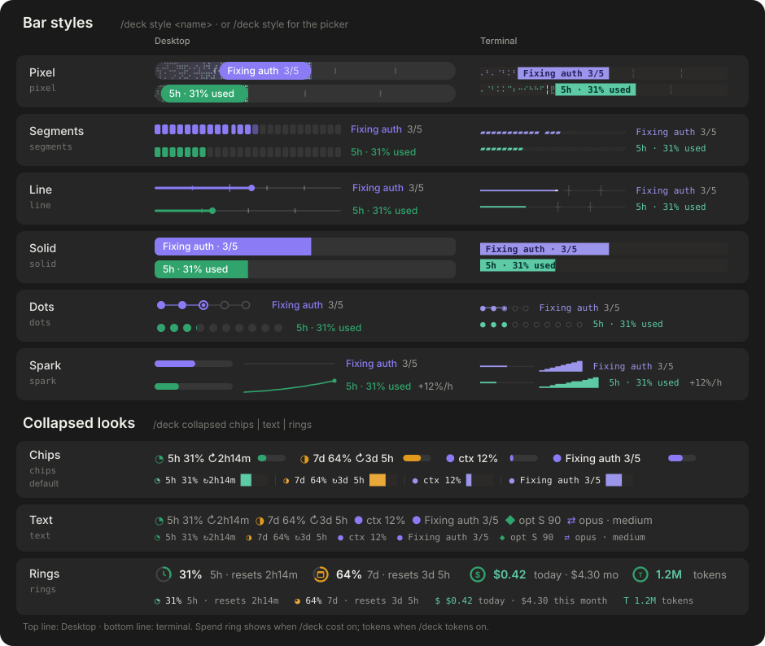

# Guide

Everything the [README](../README.md) leaves out: first run, Jev model routing, bar styles, every command, and what was changed from the original plugins.

## First run

The first time you start a session after installing, with no TypeSafe key set, the Jev router prints a **one-time** line in the transcript. It says routing is using Claude Code's built-in classifier and shows the command for saving a key (the same one in [Set up Jev model routing](#set-up-jev-model-routing)). It only prints the command: it asks for the key with hidden input and never reads or logs one.

- It shows **once**, then never again, so you can ignore it if you don't want a key.
- It stays quiet if a key is already set or you chose `provider: builtin`.
- After you save a key, restart Claude Code for it to take effect.

## Set up Jev model routing

The router asks [TypeSafe's Jev](https://typesafe.ai/blog/introducing-system-one-models-and-jev), a small decision model, how hard each task is, then picks the model and reasoning effort for it: mechanical work goes to a cheaper model, hard or risky work goes to a deeper one. Deck's **Model route** row shows every decision live, with Jev's confidence.

**It works without a key.** (See [First run](#first-run) for the one-time reminder.) With no key the router uses Claude Code's built-in classifier: nothing leaves your machine, but there is no confidence score, and it can only move a task *up*. Add a TypeSafe key to get Jev's calibrated confidence and routing in both directions.

1. **Get a key.** Create an API key in your TypeSafe account at [typesafe.ai](https://typesafe.ai).
2. **Save it.** Run this in your own terminal. The prompt hides what you paste, and the key never goes into a chat, a file, or `settings.json` (Claude Code stores it as a sensitive value):

   ```sh
   printf 'TypeSafe API key (hidden): '; read -rs K; echo
   printf '{"typesafeApiKey":"%s"}' "$K" | claude plugin configure jev-model-router@cockpit --values-stdin
   unset K
   ```

   Check it took with `claude plugin configure jev-model-router@cockpit`, which lists every option and whether it is set.
3. **Restart Claude Code** and start a new session. Run `/deck quiet off` once and look for `[jev-model-router] ready on typesafe`. If you see `built-in` instead, the key was not picked up.

Leave **Backend** on `auto`: it uses TypeSafe when a key is set. A Vercel AI Gateway key (`gatewayApiKey`) works as a fallback.

**Privacy:** with a key, the text of each prompt is sent to `api.typesafe.ai` to be classified. Check that is acceptable before using it on work projects. Saved logs hold only a redacted 200-character summary, never full prompts.

### What it changes

| Switch | Controls | Default |
|---|---|---|
| `routeSubagentModel` | the model each subagent runs on | on |
| `routeMainEffort` | the reasoning effort of your main chat | on |
| `routeMainModel` | the model of your main chat | **off** |

The main-chat model is off on purpose. Switching it mid-session throws away the prompt cache, and re-caching a long conversation can cost more than the cheaper model saves. With `cacheAware` on (the default), the router also keeps the current model when a switch would cost more over the next few turns. Turn `routeMainModel` on once you have looked at your own sessions:

```sh
printf '{"routeMainModel":"true"}' | claude plugin configure jev-model-router@cockpit --values-stdin
```

### Shadow log and auto-tune

`/jev-shadow` and `/jev-dashboard` (see [Cockpit commands](#cockpit-commands)) start empty and fill as you work. Behind them, a **shadow log** spot-checks a sample of prompts (all the ones Jev is unsure about, plus about one in ten of the rest) against Opus in the background, at most 6 calls an hour. It never changes a routing decision or delays a turn. **Auto-tune** uses that log to nudge the "unsure" floor by 0.05 at most once a day and rolls it back if escalations jump. The full details, every option and the privacy notes are in [plugins/jev-model-router/README.md](../plugins/jev-model-router/README.md).

## Bar styles

Deck's bars come in six styles: `pixel`, `segments`, `line`, `solid`, `dots` and `spark`. Run `/deck style` for a picker with live previews, or `/deck style <name>` to set one. Desktop and the terminal each keep their own choice, and `/deck collapsed chips|text|rings` changes the collapsed look.

<p align="center">
  
</p>

*Gallery from the original [claude-deck](https://github.com/nvr0x5/claude-deck) (MIT), generated from Deck's own drawing code.*

## Cockpit commands

| Command | What it does |
|---|---|
| `/deck` | Collapse or expand Deck |
| `/deck style` | Pick the bar style with live previews; `/deck style <name>` sets it directly: `pixel`, `segments`, `line`, `solid`, `dots` or `spark`. Desktop and terminal each keep their own choice |
| `/deck collapsed chips\|text\|rings` | How Deck looks when collapsed: chips with mini bars, one plain line, or limit rings; all three include the Optimizer grade when that row is on |
| `/deck size compact\|roomy` | Row spacing on Desktop (compact is the default) |
| `/deck always on\|off` | Open expanded in every new session (default on) |
| `/deck panel [off]` | Open Deck in a panel of its own, always expanded (terminal and Desktop; the VS Code extension draws none yet). It stays on, reopening each session and whenever it goes missing, until `/deck panel off` |
| `/deck cache 1h\|5m` | Prompt-cache lifetime for the Cache row (1h subscription, 5m API key) |
| `/deck <row> on\|off` | Show or hide a row: `plans agents context limits spend tokens optimizer cache route pet clock weather` |
| `/deck optimizer on\|off` | Show or hide the Optimizer row: the session's quality grade (S to F) and score from the [token-optimizer](https://github.com/alexgreensh/token-optimizer) plugin. It only appears if that plugin is installed; Deck just reads the file it writes and never runs it |
| `/deck cost on` | Also track spend per day and month |
| `/deck quiet on\|off` | Hide or show the router's own log lines (Deck already shows the route) |
| `/deck city <name>` | Set the weather city (turns the weather row on) |
| `/deck auto on\|off` | Expand Deck when something needs you |
| `/deck sound on\|off` | Turn Deck's sounds on or off |
| `/deck demo` | Play a sample plan with agents |
| `/deck clear` | Remove all bars |
| `/deck version` | Show which Deck version is running |
| `/deck status` | Print everything Deck shows |
| `/jev-shadow` | Shows how often Opus agreed with Jev, by Jev's confidence level, plus the confidence floor in force and the last tuning changes. Reads saved data only and calls no model. |
| `/jev-dashboard` | Writes a local HTML page of the router's daily numbers and opens it in your browser. `/jev-dashboard no-open` writes it without opening. |
| `/next 1`, `/next 2`, `/next 3` | Desktop app: put that next-step suggestion in the prompt box as an editable draft (the terminal uses the 1, 2, 3 and 0 keys instead) |

More Deck commands are in [plugins/deck/README.md](../plugins/deck/README.md). Spend is API-equivalent dollars; on a subscription it is not a bill.

## Modifications

Deck, next-steps and the Jev router are other people's work, changed for this bundle. What changed in each is listed in its own README:

- [Deck modifications](../plugins/deck/README.md#modifications): opens expanded in every new session, new Spend and Cache rows.
- [next-steps modifications](../plugins/next-steps/README.md#modifications): suggestions drawn in their own panel above Deck.
- [Jev router](../plugins/jev-model-router/README.md#credits): the original template plus the unsure floor, shadow log, commands, auto-tune and cache-aware switching.
